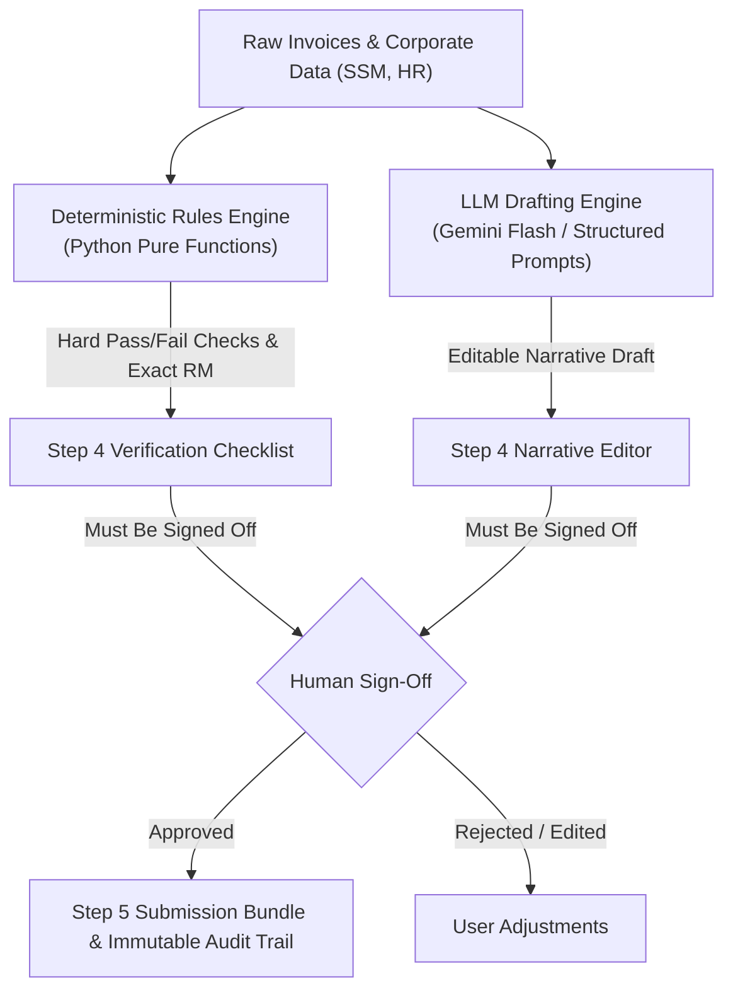

# SME Grant Copilot & Claim Engine Engineering Skill

## Overview
This skill governs the development and validation of the **Autonomous SME Grant Copilot & Claim Engine** (Problem Statement #9). It ensures absolute adherence to Malaysian government grant regulations, guarantees deterministic zero-hallucination evaluation, and preserves architectural separation between team tracks.

---

## When to Use
- Implementing or modifying grant eligibility criteria (MDEC, SME Corp, MATRADE).
- Building or refining the Step 4 Human-in-the-Loop approval and narrative editing flows.
- Modifying shared data schemas in `contract/types.ts` or Pydantic models.
- Writing unit tests for grant calculations, invoice line-item categorizations, or audit logs.
- Adding new Malaysian agency grants (e.g., MIDA, BSN, Cradle).

### When NOT to Use
- Generic tooling setup unrelated to the grant domain (e.g., editing basic ESLint rules).
- Unrelated hackathon tracks or general documentation.

---

## Core Invariants (Non-Negotiable)



### 1. Zero-Hallucination Quantitative Rules
- **NEVER** use an LLM to decide quantitative criteria:
  - Equity ownership percentages ($\ge 51\%$ or $\ge 60\%$).
  - SME Corp headcount / turnover caps (Services: $\le 75$ FTEs / $\le \text{RM20M}$; Mfg: $\le 200$ FTEs / $\le \text{RM50M}$).
  - Operational tenure in months ($\ge 6\text{ or }12$ months).
  - Grant co-funding amounts (e.g., 50% matching up to RM 5,000).
- **ALL quantitative evaluations must be executed by pure deterministic Python rules** in `backend/app/rules/`.

### 2. Contract-First Subdirectory Isolation
- **Frontend changes stay in `frontend/`**.
- **Backend changes stay in `backend/`**.
- **Shared schema changes happen ONLY in `contract/types.ts`** and must be mirrored in `backend/app/models/schemas.py`.

### 3. Human-in-the-Loop Supremacy (Step 4)
- AI-generated narratives and ROI projections are **drafts only**.
- The system must **never** auto-submit on behalf of the SME without explicit user sign-off in the UI.
- All AI narratives must be editable by the business owner or accountant before final packet export.

### 4. Immutable Audit Trail
- Every evaluation, narrative generation, threshold check, and user sign-off must append an immutable entry to `auditTrail` with a UTC timestamp and actor name.

---

## Target Malaysian Grant Matrix Quick Reference

| Agency | Scheme | Co-Funding Ceiling | Hard Deterministic Rules | Document Checklist |
| :--- | :--- | :--- | :--- | :--- |
| **MDEC / BSN** | **MSME Digital Grant MADANI** | 50% matching up to **RM 5,000** | • $\ge 60\%$ Malaysian equity<br>• $\ge 6$ mos in operation<br>• $\ge \text{RM 50,000}$ annual turnover<br>• Vendor must be an **MDEC-accredited TSP**<br>• Scope: e-Invoicing, ERP, HR/Payroll | SSM BizProfile, 2-Month Bank Statements, TSP Official Tax Invoice, Declaration Form |
| **SME Corp** | **Smart Automation Grant (SAG)** | 50% matching up to **RM 1,000,000** | • $\ge 51\%$ Malaysian equity<br>• $\ge 12$ mos in operation<br>• $< 20\%$ GLC/MNC ownership<br>• Sector Cap (Services: $\le 75$ FTEs or $\le \text{RM20M}$; Mfg: $\le 200$ FTEs or $\le \text{RM50M}$)<br>• Scope: Industrial automation / machinery | 2-Year Audited Accounts, Factory Site Plan & Machinery Layout, SSM Profile, Man-hour Reduction Justification |
| **MATRADE** | **Market Development Grant (MDG)** | 100% reimbursable up to **RM 300,000** lifetime | • $\ge 60\%$ Malaysian equity<br>• $\ge 12$ mos in operation<br>• Active Malaysian Exporter Registry status<br>• Scope: International trade exhibitions, export marketing | MATRADE Exporter Certificate, Trade Fair Booth Receipt, Commercial Export Invoices, Product Brochure |

---

## Common Mistakes & How to Avoid Them

| Mistake | Why It Breaks the Project | Correct Approach |
| :--- | :--- | :--- |
| ❌ Asking LLM in prompt: *"Is this company eligible for the MDEC grant?"* | LLMs hallucinate numbers and miss edge-case statutory caps. | Evaluate via `MdecDigitalGrantRule.evaluate()` in Python, then feed results into LLM solely to write the justification narrative. |
| ❌ Importing backend code directly into `frontend/` | Breaks Turborepo independence and causes cross-runtime bundler crashes. | Consume the contract via `@/types/claim` and communicate over HTTP REST (`POST /api/v1/claims/evaluate`). |
| ❌ Omitting fallback narratives when Gemini API key is missing | Breaks the demo or judges' evaluation if testing offline or with expired API keys. | Always provide domain-accurate template fallbacks in `backend/app/services/llm_service.py`. |
| ❌ Auto-pushing git commits without user consent | Violates repository workflow and risks pushing work-in-progress code. | Commit locally or prepare diffs, leaving the final `git push` to the user. |

---

## Verification Runbook

Before claiming any task is complete, run the project verification suite:

1. **Verify Backend Tests**:
   ```bash
   cd backend && python3 -m pytest tests/
   ```
   *Expected: All rule evaluations pass with exact Malaysian thresholds.*

2. **Verify Frontend Build**:
   ```bash
   npm --prefix frontend run build
   ```
   *Expected: Clean static page build without TypeScript or bundler errors.*

3. **Verify Turborepo Monorepo**:
   ```bash
   npm run build
   ```
   *Expected: Turborepo reports `2 successful, 2 total`.*
