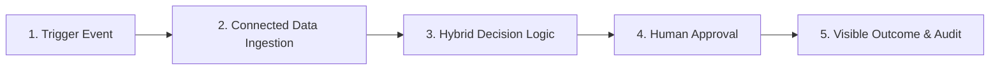
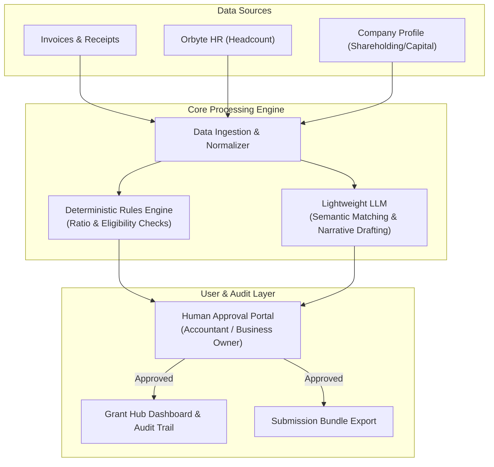

# 🚀 Autonomous SME Grant Copilot & Claim Engine

> **Empowering SMEs to discover, verify, and auto-generate grant claims seamlessly.**  
> Built for **SDCHACK 2026**.

---

## 📌 Overview

Many Small and Medium Enterprises (SMEs) miss out on government grants and co-funding opportunities due to complex eligibility criteria, fragmented company data, and tedious paperwork. 

Our solution bridges this gap with an **event-driven, automated grant discovery and claims assistant**. By fusing real-time business events with connected metadata (HR, financials, and invoices), a hybrid rules-and-LLM engine evaluates eligibility, verifies strict compliance ratios, and drafts submission-ready grant packets—keeping humans firmly in the loop for final approval.

---

## 🔄 The 5-Step Core Journey



### 1. ⚡ Trigger
Automated event-based triggers ensure no grant opportunity or claim window is missed:
- An SME incurs an eligible digital or capital expenditure (e.g., software subscription, hardware purchase, productivity tools).
- A new government or institutional grant cycle opens.
- A scheduled periodic audit runs to scan historical expenses against available funding schemes.

### 2. 🔗 Connected Data Ingestion
Aggregates both structured organizational metadata and unstructured transactional data:
- **Company Metadata**: Paid-up capital, local shareholding percentage, corporate structure.
- **HR & Employment Data**: Full-time equivalent (FTE) headcount, local hiring ratios (e.g., Orbyte HR).
- **Financial Records**: Accounting invoices, receipts, and line-item expenditure details.

### 3. 🧠 Decision Logic (Rules Engine + Lightweight LLM)
A two-layer evaluation engine guarantees both precision and human-like narrative synthesis:
- **Deterministic Rules Engine**: Mathematically checks hard constraints (e.g., $\ge 30\%$ local shareholding, headcount caps, qualifying expense dates).
- **Lightweight LLM Parsing & Generation**: Parses invoice descriptions, matches them against grant taxonomy, and drafts mandatory grant justification narratives and documentation outlines.

### 4. 👤 Human-in-the-Loop Review
Trust and compliance are paramount:
- The business owner or appointed accountant receives a pre-filled claims package preview.
- Discrepancies or edge-case flags are highlighted.
- One-click approval or inline edits before final submission.

### 5. 🎯 Visible Outcome & Dashboard
- **Export Ready**: Complete application packet generated in standard format (PDF/DOCX/JSON) alongside an immutable audit trail.
- **Grant Hub Dashboard**: Status tracking, claimed vs. eligible amounts, timeline milestones, and historic audit records.

---

## 🏗️ System Architecture



---

## 🛠️ Proposed Tech Stack

- **Frontend / Dashboard**: Next.js / React, Tailwind CSS, shadcn/ui
- **Backend / API**: FastAPI / Python or Node.js (TypeScript)
- **Decision Engine**: Python Rule Engine + Pydantic (Type & Schema Validation)
- **AI / LLM**: Fast LLM inference (e.g., Gemini 1.5 / 2.0 Flash) for invoice parsing & narrative drafting
- **Database & Storage**: PostgreSQL / SQLite (metadata & audit trails), Vector DB (if matching against grant policy documents)

---

## 👥 Team & Git Branches

To ensure smooth parallel collaboration, each team member works on an isolated branch before opening pull requests to `main`:

| Branch | Member / Focus Area |
| :--- | :--- |
| `main` | Production-ready, stable codebase |
| `wf` | Feature Branch (`wf`) |
| `jv` | Feature Branch (`jv`) |
| `zh` | Feature Branch (`zh`) |
| `wx` | Feature Branch (`wx`) |

### Branching Guidelines
1. Always branch off the latest `main`:
   ```bash
   git checkout main
   git pull origin main
   git checkout <your-branch>
   git merge main
   ```
2. Commit frequently with clear commit messages.
3. Submit a Pull Request (PR) to merge back into `main`.

---

## 🚦 Getting Started

*(Instructions will be updated as repository scaffolding is completed)*

```bash
# Clone the repository
git clone https://github.com/JV-GG/SDCHACK.git
cd SDCHACK

# Switch to your branch
git checkout <your-branch-name>
```

---

## 📄 License
Internal Hackathon Project – SDCHACK 2026.
