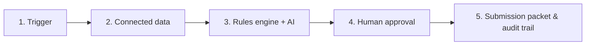
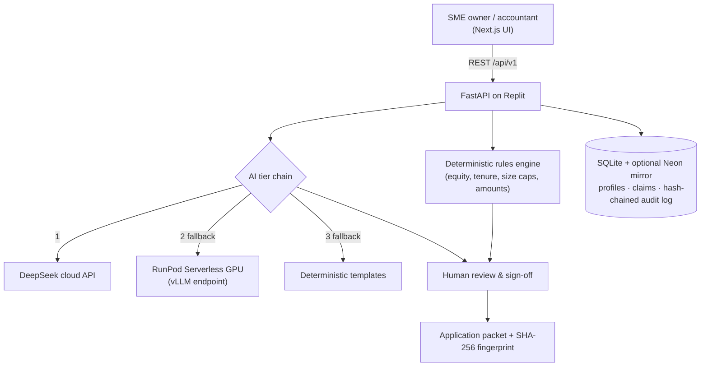

# SME GrantFlow

> Turns a Malaysian SME's own invoices and company records into ready-to-sign government grant applications (MDEC, SME Corp, MATRADE and more), so owners stop leaving matching funds unclaimed.

*Hackathon track — **Problem Statement #9: Low Awareness and Cumbersome Application for Government Grants***

---

## Team Information

| Field                  | Details                                                            |
| ---------------------- | ------------------------------------------------------------------ |
| **Team Name**          | 0x404                                                              |
| **Team Domain**        | Domain 2                                                           |
| **SDG Track (1–17)**   | SDG 9 — Industry, Innovation, and Infrastructure                   |
| **Team Leader**        | Khoo Zong Hao                                                      |
| **University**         | Asia Pacific University                                            |
| **Number of Members**  | 4                                                                  |

## Links

| Resource          | Link                                                                                     |
| ----------------- | ---------------------------------------------------------------------------------------- |
| GitHub Repository | https://github.com/JV-GG/SDCHACK                                                         |
| Replit Project    | _TODO_                                                                                   |
| Live Demo         | [https://sdchack.vercel.app](https://sdchack.vercel.app)                                 |
| RunPod Endpoint   | https://api.runpod.ai/v2/reig5yleze9o5f _(requires API key to use)_                      |
| Slide Deck        | [https://sdchack.vercel.app](https://sdchack.vercel.app)                                 |
| Demo Video        | _TODO_                                                                                   |

---

## Overview

### Problem

> _"While agencies like **MDEC**, **SME Corp**, and **MATRADE** provide digitalization grants (e.g., SME Digitalisation Grant, automation matching funds), small business owners struggle with bureaucratic documentation, strict eligibility criteria, and tedious claim processes, resulting in underutilized government support."_

Malaysian SMEs leave millions in matching funds unclaimed for three reasons:

1. **Low awareness and scattered portals.** Programmes from MDEC, SME Corp, MATRADE, HRD Corp, MIDA, MITI and Cradle open and close separately, and an SME rarely knows that an expense it already made (or is about to make) qualifies.
2. **Complex, multi-variable eligibility.** Every scheme has its own thresholds: Malaysian equity (≥51% or ≥60%), SME Corp headcount and turnover caps by sector, operating tenure, GLC/MNC ownership, approved-vendor lists and spending scope.
3. **Paperwork fatigue.** SSM profiles, vendor quotations, headcount proof and a written project justification take days of back-and-forth between owner and accountant.

### Solution

SME GrantFlow flips the process: **grants find the SME**, instead of the SME hunting through portals. It follows a five-step, event-driven journey:



1. **Trigger.** An SME submits an invoice, quotation or receipt; updates its company profile; a grant portal sync runs; or the daily scheduled scan fires.
2. **Connected data.** The company profile (SSM details, workforce headcount, turnover, export status) and the document's line items are gathered into one context.
3. **Rules engine + AI.** A **deterministic Python rules engine** decides every quantitative question (equity, tenure, size caps, amounts, co-funding) with zero hallucination. **AI is used only** to read messy invoice text and draft the project-justification narrative, and the app works fully offline with built-in templates if no AI is reachable.
4. **Human approval.** The owner reviews pass/fail checks and co-funding amounts, edits the AI draft, and signs off. Nothing is ever claimed or submitted without explicit sign-off.
5. **Outcome.** A printable application packet with a SHA-256 fingerprint, plus a tamper-evident audit trail.

> **Data note.** Company data (SSM, headcount, turnover) is **self-declared** in this prototype; live SSM, Orbyte HR and accounting integrations are not connected, and the UI says so. The grant catalogue and **application-window dates are illustrative demo data** modelled on public programme criteria. Confirm real criteria and dates with each agency before relying on them.

### Key Features

- **Year-round opportunity radar.** Checks the company profile against every scheme **without needing an invoice**, shows each programme's application window (open year-round, closing in N days, opening soon), what to do next, and an **Apply with quotation** flow for schemes that require approval before purchase.
- **Deterministic eligibility for 7 schemes.** MDEC MSME Digital Grant, SME Corp Smart Automation Grant, MATRADE Market Development Grant, HRD Corp SBL-Khas, MIDA DISF, MITI Industry4WRD and Cradle CIP Spark. Each rule is split into company-level checks and invoice-level checks, with plain-language "how to qualify" advice for every failed rule.
- **AI where it helps, never where it decides.** Invoice text parsing and narrative drafting through a three-tier chain: DeepSeek cloud → RunPod GPU → deterministic template.
- **Human-in-the-loop.** Editable narratives, one sign-off for multi-agency grant stacking, and a confirmation dialog (old → new values, programmes gained or lost) before any profile edit is saved.
- **Editable organisation profile** with per-field "which programmes does this meet?" insights, a live eligibility preview, and operating tenure calculated from the incorporation date.
- **Tamper-evident audit trail.** Written by the server, never the browser, with time, company account email and client IP for sign-in, profile changes, documents, evaluation, sign-off and submission; entries are SHA-256 hash-chained and the page reports if the chain is broken. A claim picker shows the history of every claim.
- **Polished UX.** Skeleton loading on every page, smooth page and dialog transitions, and full respect for reduced-motion settings.

### Target grant matrix

| Agency | Scheme | Target expenditure | Key deterministic rules |
| :----- | :----- | :----------------- | :---------------------- |
| **MDEC** (with BSN) | MSME Digital Grant MADANI | e-Invoicing, ERP, HR/Payroll — 50% matching, up to RM5,000 | ≥60% Malaysian equity · ≥6 months operating · ≥RM50k turnover · MDEC-approved TSP vendor |
| **SME Corp** | Smart Automation Grant (SAG) | Automation machinery — 50% matching, up to RM1M | ≥51% equity · ≥12 months · non-GLC/MNC · SME size cap (Services ≤75 FTE or ≤RM20M; Manufacturing ≤200 FTE or ≤RM50M) |
| **MATRADE** | Market Development Grant (MDG) | Trade fairs, export promotion — 100% reimbursable, up to RM300k | ≥60% equity · ≥12 months · registered active exporter |
| **HRD Corp** | SBL-Khas | HR/Payroll and workforce training — up to RM25k | ≥51% equity · ≥10 full-time employees · ≥6 months |
| **MIDA** | DISF Automation | Major automation CapEx ≥RM250k — 60%, up to RM500k | ≥60% equity · Manufacturing · ≥24 months · turnover ≥RM500k |
| **MITI** | Industry4WRD Intervention Fund | ERP/MES **and** automation hardware — 70%, up to RM500k | ≥60% equity · Manufacturing SME · ≥36 months |
| **Cradle Fund** | CIP Spark | Cloud/software commercialisation — 80%, up to RM150k | ≥51% equity · 6–36 months · turnover ≤RM5M · independent |

### Tech Stack

| Layer         | Technology                                                                                          |
| ------------- | --------------------------------------------------------------------------------------------------- |
| Frontend      | Next.js 16, React 19, TypeScript, Tailwind CSS 4, Lucide icons                                      |
| Backend       | Python, FastAPI, Pydantic v2                                                                        |
| Database      | SQLite (local, authoritative) with an optional Neon PostgreSQL mirror                               |
| AI / Compute  | RunPod Serverless GPU (vLLM, DeepSeek-R1-Distill-Qwen-7B) · DeepSeek cloud API · offline templates |
| Hosting / Dev | Replit                                                                                              |

---

## Project Structure

```
.
├── backend/                       # FastAPI service
│   ├── app/
│   │   ├── api/routes.py          # REST endpoints and event triggers
│   │   ├── rules/                 # Deterministic grant rules, one file per scheme
│   │   ├── services/              # evaluator, llm_service (AI tiers), opportunity_service,
│   │   │                          # profile_service, audit_service (hash chain), db_service
│   │   ├── models/schemas.py      # Pydantic models (mirrors contract/types.ts)
│   │   └── main.py                # App entry point + scheduled scan
│   ├── data/scenarios.json        # Demo SMEs and invoices
│   └── tests/                     # pytest suite (rules, API, audit, profile, opportunities)
├── frontend/                      # Next.js app (Grant Hub, Submitted, Connected data, Audit trail)
├── contract/types.ts              # Shared TypeScript contract for the API
├── docs/                          # Planning notes, screenshots, diagrams
├── runpod/                        # How the RunPod GPU endpoint is used
├── submission/                    # Required submission documents
│   ├── SDC2026_0x404_Preliminary.pdf      # Preliminary submission
│   ├── SDC2026_0x404_TechDeclaration.pdf  # Technology declaration
│   ├── SDC2026_0x404_Replit_POU.pdf       # Replit proof of use
│   └── SDC2026_0x404_Runpod_POU.pdf       # RunPod proof of use
├── .env.example                   # Example environment variables
├── .gitignore
├── .replit                        # Replit run configuration (starts the API)
├── LICENSE
├── requirements.txt               # Points at backend/requirements.txt
└── README.md
```

### Architecture



---

## How to Run

Prerequisites: Python 3.11+ and Node.js 20+. No API keys are needed to try the app: with none set it runs fully offline on local SQLite with the deterministic narrative engine.

### Option 1 — Run on Replit (Recommended)

1. Open the Replit Project _(link above — TODO)_, or import this repository via **Create Repl → Import from GitHub**.
2. Open the **Secrets** tab (🔒) and add any of the variables listed in `.env.example` (all optional):
   - `RUNPOD_API_KEY`, `RUNPOD_BASE_URL`, `RUNPOD_MODEL`
   - `DEEPSEEK_API_KEY`, `DEEPSEEK_BASE_URL`, `DEEPSEEK_MODEL`
   - `DATABASE_URL` (Neon mirror)
3. Click **Run**. Replit uses the `.replit` file to install `backend/requirements.txt` and start the API with `uvicorn app.main:app --port 8000`.
4. Start the web app in a second shell: `cd frontend && npm install && npm run dev`.

### Option 2 — Run Locally

```bash
# 1. Clone the repository
git clone https://github.com/JV-GG/SDCHACK.git
cd SDCHACK

# 2. Backend: create a virtual environment and install dependencies
cd backend
python3 -m venv venv
source venv/bin/activate        # Windows: venv\Scripts\activate
pip install -r requirements.txt

# 3. Configure environment variables (optional)
cp ../.env.example .env         # then fill in your values; skip it to run offline

# 4. Start the API on http://localhost:8000  (docs at /api/v1/docs)
uvicorn app.main:app --reload --port 8000

# 5. In a second terminal, start the web app on http://localhost:3000
cd frontend
npm install
npm run dev
```

Open http://localhost:3000. Three demo companies are pre-loaded (use the switcher in the sidebar; the demo password is `demo123`). Try **New Invoice Trigger** with a preset invoice, or **Programmes you can apply for → Apply with quotation**.

### Run Tests

```bash
cd backend
python -m pytest tests/
```

---

## How We Use Replit *(Required)*

- **Development:** Collaborative development, environment configuration, and API prototyping using Replit workspace and secrets management.
- **Hosting:** `.replit` configures the FastAPI backend service (`uvicorn app.main:app`, port 8000) exposing REST API endpoints to the Next.js frontend web app (deployed at https://sdchack.vercel.app).
- **Secrets:** API keys and the database URL are stored in Replit Secrets, never in the code (`backend/.env` is git-ignored).

📄 Proof of use: [`submission/SDC2026_0x404_Replit_POU.pdf`](submission/SDC2026_0x404_Replit_POU.pdf)

## How We Use RunPod *(Required)*

- **Workload:** Model inference on a RunPod GPU: parsing unstructured invoice text and drafting grant justification narratives with `deepseek-ai/DeepSeek-R1-Distill-Qwen-7B`.
- **Setup:** A RunPod **Serverless vLLM endpoint** (ID `reig5yleze9o5f`), which exposes an OpenAI-compatible API. It is tier 2 of the AI chain, used when the DeepSeek cloud API is unavailable. Details in [`runpod/README.md`](runpod/README.md).
- **Integration:** The FastAPI backend sends requests using `RUNPOD_API_KEY` and `RUNPOD_BASE_URL` (see `_dispatch_chat_completion` in `backend/app/services/llm_service.py`).
- **Safety by design:** The GPU model never decides eligibility or amounts. Those come from the deterministic rules engine.

Example request:

```bash
curl -X POST https://api.runpod.ai/v2/$RUNPOD_ENDPOINT_ID/openai/v1/chat/completions \
  -H "Authorization: Bearer $RUNPOD_API_KEY" \
  -H "Content-Type: application/json" \
  -d '{"model": "deepseek-ai/DeepSeek-R1-Distill-Qwen-7B", "messages": [{"role": "user", "content": "Hello"}]}'
```

📄 Proof of use: [`submission/SDC2026_0x404_Runpod_POU.pdf`](submission/SDC2026_0x404_Runpod_POU.pdf)

---

## Challenges & Learnings

- **Keeping AI away from the numbers.** Grant thresholds must be exact, so every quantitative decision lives in plain Python rules, split into company-level and invoice-level stages. That split is also what made year-round eligibility possible without an invoice.
- **A trustworthy audit trail.** An early version let the browser write audit entries and re-created a claim on every page reload. We moved all logging to the server, made it append-only with a SHA-256 hash chain, and recorded the account email and IP address.
- **Being honest about data.** SSM, HR and accounting connectors are simulated, so the UI labels values as self-declared and the README says so.
- **Demystifying fragmented Malaysian grant regulations.** Navigating overlapping schemes across MDEC, SME Corp, MATRADE, and MIDA showed us how difficult it is for real business owners to decipher contrasting equity rules (51% vs 60%), sector-based headcount and turnover caps, and TSP vendor whitelists. Codifying these complex policies into automated, deterministic checks paired with actionable "how to qualify" advice proved to us that software can bridge the gap between government funding and under-resourced SMEs without risking hallucination.

## Future Improvements

- [ ] Live integrations: SSM e-Info, Orbyte HR and accounting ledgers, so profile data is pulled instead of typed
- [ ] Crawl real agency portals for scheme criteria and application windows
- [ ] Per-employee accounts and roles, instead of one login per company
- [ ] PDF/OCR invoice upload with extraction directly on the RunPod endpoint
- [ ] Direct submission to agency portals after human sign-off

## Team

| Name | Role |
| :--- | :--- |
| Khoo Zong Hao | Team Leader (Full Stack) |
| Kee Wen Fei | Full Stack |
| Chen Jun Voon | Full Stack |
| Tay Wei Xiang | Full Stack |

---

## Submission Checklist

- [x] Team name, domain (Domain 1 / Domain 2) and SDG track filled in
- [ ] Slide deck link added
- [ ] Demo video link added
- [ ] Replit used, with proof of use in `submission/`
- [ ] RunPod used, with proof of use in `submission/`
- [ ] Preliminary submission completed (`SDC2026_0x404_Preliminary.pdf`)
- [ ] Technology declaration completed (`SDC2026_0x404_TechDeclaration.pdf`)
- [x] Submission files renamed with your team name (`0x404`)
- [ ] "How to Run" steps verified
- [x] No API keys or secrets in the current source tree *(the database password that was hardcoded in `backend/app/core/config.py` is removed; it remains in git history, so rotate it before submitting — see notes)*

## License

This project is licensed under the [Apache License 2.0](LICENSE).
