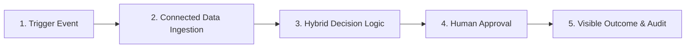
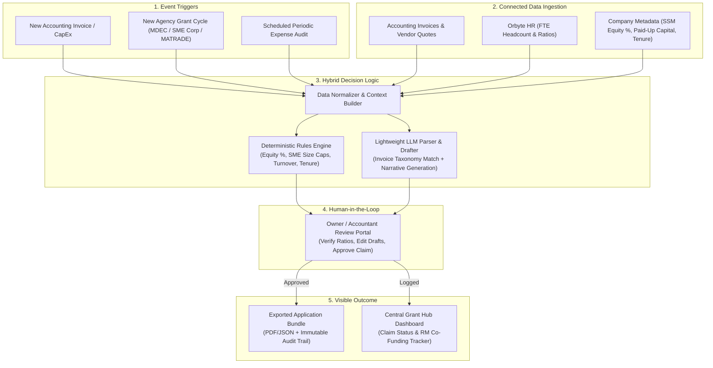

# 🚀 Autonomous SME GrantFlow & Claim Engine

> **Hackathon Track — Problem Statement #9: Low Awareness and Cumbersome Application for Government Grants**  
> *Transforming passive, bureaucratic Malaysian SME grant applications into an automated, event-driven claims pipeline.*

---

## 🎯 Problem Statement (#9)

> *"While agencies like **MDEC**, **SME Corp**, and **MATRADE** provide digitalization grants (e.g., SME Digitalisation Grant, automation matching funds), small business owners struggle with bureaucratic documentation, strict eligibility criteria, and tedious claim processes, resulting in underutilized government support."*

### Why Malaysian SMEs Leave Millions on the Table
1. **Low Awareness & Fragmented Portals**: Grant windows (under Budget / MADANI frameworks) open and close across separate agencies (**MDEC**, **SME Corp**, **MATRADE**, **BSN**, **MIDA**) with limited quota allocations. SMEs rarely know an expense they *already incurred* qualifies for co-funding.
2. **Complex, Multi-Variable Eligibility Rules**: Every agency enforces distinct hard ratios—Malaysian equity shareholding ($\ge 51\%$ vs. $\ge 60\%$), sector-specific SME Corp headcount/turnover caps (Manufacturing vs. Services), minimum operation tenure, and approved vendor whitelists (e.g., MDEC TSPs).
3. **Bureaucratic Documentation & Narrative Fatigue**: Compiling SSM forms, management accounts, HR headcount proofs, vendor quotations, and writing project justification narratives takes days of back-and-forth between business owners and accountants.

---

## 💡 Our Solution: The 5-Step Core Journey

Instead of forcing SME owners to manually search portals and decipher PDF guidelines, our platform flips the paradigm: **grants find the SME automatically based on real operational data.**



### 1. ⚡ Trigger (Solves Low Awareness)
Automated event-based triggers ensure no grant opportunity or claim window is missed:
- **Expense Incurred**: An SME logs an eligible digital, capital, or export expenditure (e.g., purchasing e-Invoicing/ERP software, automation machinery, or overseas trade booth fees).
- **Grant Cycle Opens**: A new government grant window or budget allocation is announced by MDEC, SME Corp, or MATRADE.
- **Periodic Audit**: A scheduled retrospective scan checks recent accounting expenditures against active matching grants.

### 2. 🔗 Connected Data Ingestion (Eliminates Data Silos)
Automatically pulls required verification data from connected business systems without manual spreadsheet hunting:
- **Corporate Metadata (SSM / Company Profile)**: Paid-up capital, Malaysian shareholding percentage, incorporation date, sector classification, and GLC shareholding status.
- **HR & Workforce Data (Orbyte HR)**: Full-time equivalent (FTE) employee headcount and local-to-foreign workforce ratios.
- **Financial & Accounting Records**: Vendor invoices, official quotations, Technology Solution Provider (TSP) registration details, and annual sales turnover metrics.

### 3. 🧠 Decision Logic: Rules Engine + Lightweight LLM (Solves Criteria & Paperwork)
A hybrid evaluation architecture combining deterministic precision with generative drafting:
- **Deterministic Rules Engine**: Evaluates strict quantitative criteria with zero hallucination:
  - *Equity Check*: e.g., $\ge 60\%$ Malaysian-owned for MSME Digital Grant & MATRADE MDG; $\ge 51\%$ for Smart Automation Grant.
  - *SME Corp Classification*: Validates Services ($\le \text{RM20M}$ turnover or $\le 75$ FTEs) vs. Manufacturing ($\le \text{RM50M}$ turnover or $\le 200$ FTEs).
  - *Prerequisite Ratios*: Verifies minimum annual turnover (e.g., $\ge \text{RM50k}$), operational tenure ($\ge 6\text{–}12\text{ months}$), and matching cap limits.
- **Lightweight LLM Parsing & Drafting**:
  - Parses unstructured invoice line items and maps them to grant-eligible categories.
  - Auto-generates mandatory application narratives (e.g., digital transformation justification, productivity ROI projections, export market readiness summary).

### 4. 👤 Human Approval (Accountability & Compliance)
Human-in-the-loop verification keeps the business owner or accountant in full control:
- Reviews a unified **Claims Readiness Package** showing matched grants, pass/fail eligibility checks, and calculated co-funding amounts.
- Inspects and edits LLM-drafted justification narratives and flagged edge cases.
- One-click sign-off and approval.

### 5. 🎯 Visible Outcome (Ready-to-Submit Bundle & Audit Trail)
- **Exported Application Packet**: Generates a complete, submission-ready bundle (pre-filled agency forms, invoice attachments, HR/SSM verification summary, and immutable compliance audit trail).
- **Grant Hub Dashboard**: Central visibility into discovered grants, pending approvals, potential RM savings, and historical claim audit logs.

---

## 🏛️ Domain Research: Target Malaysian Grant Matrix

Our Rules Engine + LLM pipeline is designed around real Malaysian grant frameworks across the three core agencies mentioned in the problem statement:

| Agency | Flagship Grant Scheme | Target Expenditure | Key Deterministic Rules (Rules Engine) | Narrative & Doc Requirements (LLM + Bundle) |
| :--- | :--- | :--- | :--- | :--- |
| **MDEC** *(with BSN)* | **MSME Digital Grant MADANI** *(SME Digitalisation Grant)* | e-Invoicing, HR/Payroll, Accounting, CRM, E-Commerce, Cybersecurity (50% matching up to RM5,000) | • $\ge 60\%$ Malaysian equity<br>• $\ge 6$ months in operation<br>• Min RM50k annual turnover<br>• Vendor must be an MDEC-approved TSP | • Invoice line-item to digital category mapping<br>• SSM BizProfile, 2-month bank summary, TSP quotation bundle |
| **SME Corp** *(with MIDA / MDEC)* | **Smart Automation Grant (SAG)** & **Business Accelerator (BAP)** | Manufacturing automation equipment, smart service workflows, productivity systems (matching grant) | • $\ge 51\%$ Malaysian equity<br>• $\ge 12$ months in operation<br>• SME Corp sector cap ($\le 75$ FTE Services / $\le 200$ FTE Mfg)<br>• $< 20\%$ GLC/MNC ownership | • Automation ROI & productivity impact narrative<br>• Pre/post man-hour reduction justification & technical scope draft |
| **MATRADE** | **Market Development Grant (MDG)** | International trade fairs, B2B export missions, digital export marketing (reimbursable up to RM300k lifetime cap) | • $\ge 60\%$ Malaysian equity<br>• $\ge 12$ months in operation<br>• Non-GLC status<br>• Active exporter of Made-in-Malaysia goods/services | • Export market expansion justification<br>• Proof of exhibition/marketing invoice & export readiness summary |

---

## 🏗️ System Architecture



---

## 🛠️ Proposed Tech Stack

- **Frontend / Grant Hub UI**: Next.js / React, Tailwind CSS, shadcn/ui
- **Backend / Orchestration**: FastAPI (Python) or Node.js (TypeScript)
- **Deterministic Rules Engine**: Python Rule Engine + Pydantic (strict schema validation for SSM, Orbyte HR, and grant thresholds)
- **AI / Lightweight LLM**: Gemini Flash / OpenAI mini for invoice OCR/parsing, semantic grant matching, and narrative generation
- **Database & Audit Storage**: PostgreSQL / SQLite (company profiles, rules catalog, and immutable claim audit logs)

---

## 👥 Team & Git Branches

Each team member works on an isolated branch before merging into `main`:

| Branch | Purpose / Owner |
| :--- | :--- |
| `main` | Stable, integrated hackathon branch |
| `wf` | Feature Branch (`wf`) |
| `jv` | Feature Branch (`jv`) |
| `zh` | Feature Branch (`zh`) |
| `wx` | Feature Branch (`wx`) |

### Quick Git Workflow
```bash
# Switch to your branch and sync with latest main
git fetch origin
git checkout <your-branch>
git merge origin/main

# Push your changes
git add .
git commit -m "feat: your commit message"
git push origin <your-branch>
```

---

## 📄 License
Built for **SDCHACK 2026** — Problem Statement #9.
